<p align="center">
  
</p>

<h1 align="center">Teoría de la computación: ejercicios</h1>

<p align="center">
  
  
  
</p>

Tres ejercicios de los parciales de **Introducción a la Teoría de la Computación**, resueltos en cuadernos de Google Colab. Cada uno parte de la definición formal (un DFA como 5-tupla, una gramática libre de contexto) y la convierte en código que se puede ejecutar: simular un autómata, decidir si una gramática genera una cadena y decidir si dos autómatas reconocen el mismo lenguaje.

---

## Los tres cuadernos

| # | Cuaderno | Tema | Abrir |
|---|---|---|---|
| 1 | [Parcial 1, punto 2.a](notebooks/parcial-1-punto-2a-simulacion-dfa.ipynb) | Simulación de un DFA | [](https://colab.research.google.com/github/jerofax/teoria-de-la-computacion/blob/main/notebooks/parcial-1-punto-2a-simulacion-dfa.ipynb) |
| 2 | [Parcial 2, punto 7](notebooks/parcial-2-punto-7-fnc-y-cyk.ipynb) | Forma Normal de Chomsky y algoritmo CYK | [](https://colab.research.google.com/github/jerofax/teoria-de-la-computacion/blob/main/notebooks/parcial-2-punto-7-fnc-y-cyk.ipynb) |
| 3 | [Parcial 3, punto 5.b](notebooks/parcial-3-punto-5b-equivalencia-dfa.ipynb) | Equivalencia de DFA ($EQ_{\text{DFA}}$) | [](https://colab.research.google.com/github/jerofax/teoria-de-la-computacion/blob/main/notebooks/parcial-3-punto-5b-equivalencia-dfa.ipynb) |

### 1. Simulación de un DFA (parcial 1, punto 2.a)

Dado un autómata finito determinista $M = (Q, \Sigma, \delta, q_0, F)$ y una cadena $w$, decide si $M$ acepta $w$.

- **Entrada:** el DFA como tabla en un `.csv` (cargada con pandas) y la cadena en un `.txt`.
- **Idea:** construir la sucesión de estados $r_0 = q_0$, $r_i = \delta(r_{i-1}, w_i)$ y revisar si $r_n \in F$. Imprime *"w es aceptada por M"* o *"w no es aceptada por M"*.
- **Ejemplos:** tres DFA y tres cadenas, con la comprobación de qué cadena acepta cada autómata.
- **Conclusión del cuaderno:** la simulación es $O(n)$ en la longitud de la cadena y no depende del número de estados. Por eso, aunque la construcción de subconjuntos convierta un NFA de $k$ estados en un DFA de hasta $2^k$ estados, simular el DFA resultante sigue siendo lineal.

### 2. Forma Normal de Chomsky y CYK (parcial 2, punto 7)

Parte de la gramática de expresiones aritméticas

$$
E \to E + T \mid T, \qquad T \to T * F \mid F, \qquad F \to (E) \mid a
$$

- **FNC a mano:** se lleva la gramática a Forma Normal de Chomsky paso a paso (producciones vacías, unitarias, terminales aislados y lados derechos de longitud 2).
- **CYK:** implementa el algoritmo con la tabla triangular $T[i][l]$ de no terminales que generan cada subcadena, y decide si la cadena pertenece al lenguaje.
- **Árbol de derivación:** extiende CYK con una tabla de punteros $P[i][l]$ para reconstruir el árbol y lo dibuja con networkx. El ejemplo desarrollado en el texto es $w = \texttt{a+a+a}$.
- **Conclusión del cuaderno:** CYK evita la explosión exponencial de revisar todas las derivaciones y queda en $O(n^3 \cdot |G|)$.

### 3. Equivalencia de DFA (parcial 3, punto 5.b)

Decide si dos DFA reconocen el mismo lenguaje.

- **Idea:** $L(M_1) = L(M_2)$ si y solo si la diferencia simétrica es vacía. Se construye el autómata de $\big(L(M_1) \cap \overline{L(M_2)}\big) \cup \big(\overline{L(M_1)} \cap L(M_2)\big)$ con complemento, producto e intersección, y la unión se obtiene por De Morgan.
- **Vaciedad:** un BFS desde el estado inicial busca un estado de aceptación alcanzable. Si lo encuentra, devuelve la **cadena contraejemplo más corta**.
- **Ejemplo:** `DFA1` y `DFA2` aceptan las cadenas que terminan en 1 (con 2 y 3 estados) y el cuaderno concluye que son equivalentes. `DFA3` acepta las cadenas con un número impar de ceros.
- **Conclusión del cuaderno:** el problema es decidible y el algoritmo corre en $O(|Q_1| \cdot |Q_2| \cdot |\Sigma|)$.

## Estructura del repositorio

```text
teoria-de-la-computacion/
├── notebooks/
│   ├── parcial-1-punto-2a-simulacion-dfa.ipynb
│   ├── parcial-2-punto-7-fnc-y-cyk.ipynb
│   └── parcial-3-punto-5b-equivalencia-dfa.ipynb
├── data/
│   ├── DFA1.csv          # usados por el cuaderno 3
│   ├── DFA2.csv
│   └── DFA3.csv
├── assets/banner.svg
└── LICENSE
```

## Cómo ejecutarlos

**En Colab:** usa los botones de la tabla. Los cuadernos leen sus archivos de entrada desde la carpeta de trabajo, así que antes de ejecutar hay que subirlos al panel de archivos de Colab:

- Cuaderno 3: sube `DFA1.csv` y `DFA2.csv` de [`data/`](data/).
- Cuaderno 1: necesita `DFA(1).csv`, `DFA(2).csv`, `DFA(3).csv` y `cadena(1).txt`, `cadena(2).txt`, `cadena(3).txt`. [COMPLETAR: subir estos archivos a `data/`]
- Cuaderno 2: no necesita archivos; pide la cadena con `input()`.

**En local:**

```bash
git clone https://github.com/jerofax/teoria-de-la-computacion.git
cd teoria-de-la-computacion
pip install pandas networkx matplotlib jupyter
jupyter notebook notebooks/
```

Jupyter ejecuta cada cuaderno desde su propia carpeta, así que copia en `notebooks/` los archivos de entrada que use (por ejemplo, los `.csv` de `data/`).

## Referencias

- [COMPLETAR: texto guía del curso]

## Licencia

[MIT](LICENSE).

---

<p align="center">Hecho por <a href="https://github.com/jerofax">Jerónimo Restrepo</a> · <a href="https://jerofax.github.io">jerofax.github.io</a></p>
